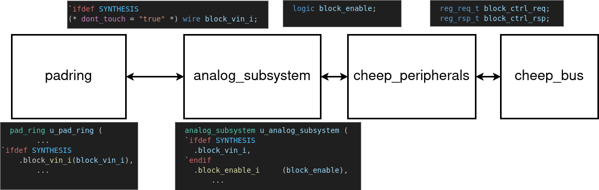

# Analog subsystem

The analog subsystem (ss), instantiated at `cheep_top` level, connects to the `cheep_peripherals` ss to get all the control signals for the analog blocks.

## Cheep Peripherals level

In the `cheep_peripherals` ss we now have the RTL digital back-end of the analog blocks: `vco_decoder` and `idac_ctrl`. These have a register interface where configurations are written to, they parse them and also generate control signals (e.g. `refresh`).

## Cheep top level

At `cheep_top` level, control signals are passed both to the analog ss and to the DMA (refresh notifications).

## Analog subsystem level

Here the digital signals are passed to the analog block models. Depending on the type of simulation, one or another block will be instantiated. All the different versions of these blocks are stored in `hw/vendor/analog-library`. Please refer to the [documentation of the library](../vendor/analog-library/README.md) to see how to add new blocks.

# How to add new peripherals

There are 3 steps to adding new peripherals:
1. Creating the peripheral (duuuh) - this is done [in the analog-library](#in-the-analog-library)
2. Adding it into the analog subsystem of the cheep - this is done [in the analog_subsystem](#in-the-analog_subsystem)
3. Adding the controller to interface the digital and analog sides - this is done [in the cheep_peripherals](#in-the-cheep_peripherals), and later connected [in the cheep_top](#in-the-cheep_top).

> ⚠️ **It' i's SUPER IMPORTANT that you are consistent with names!** I'm not kidding, it's where most of the time will be lost otherwise. So pick a name for your block early on, and make sure that it represents the block and it's not `my_block_v2`. The capitalization of the name and whether it has dashes `-` or underscores `_` is important. My advice: avoid these special characters for everyone's sake.
>
> Similarly, be super careful when naming pins. Do not add the block's name into the pins, it will just make things more confusing. If you need `VDD`, just name it `VDD`, if you need clock, just name it `CLK`, etc.
> The hardware pins (those find on the LIB, LEF, GDS, etc) should be named in `ALL_CAPS`, so to distinguish them from the names found on the RTL, which are `lower_case`. This way we know that `Vin_int_uV` is a behavioral input, and that it's not actually a real signal.

## In the `analog-library`
The analog library is a hard copy inside `hw/vendor/analog-library`. Edit it directly in this repository.

The minimum components you need to have on the analog library for a block are:

### `include/block.sv`

This should have a SystemVerilog package where you can define any parameter of your block

### `LEF/BLOCK.lef`

The LEF file describes the physical view of the block (pins and dimensions). It is only needed for physical implementation, not for RTL simulation.

The important thing of this LEF is that it has the pins that will be actually present on the physical block, and that their names correspond to the names found later on the GDS. These pin names will be used later [in the analog_subsystem](#in-the-analog_subsystem).

### `Verilog/BLOCK.sv`

The behavioral model of the block, with module name `<BLOCK>`

Power pins should go inside a conditional of `USE_PG_PIN`. Analog input and outputs should be replaced for "behavioral counterparts", which treat analog signals as integers (in the example below, 32 bits). Make it clear by naming them `_int_` and appending the units. These pins should have the same name as in the LEF, but with this appendix.

```sv
`ifdef USE_PG_PIN
    inout   wire        VCO_VSS,
    inout   wire        DCORE_VDD,
`endif
    input  logic [31:0] VIN_int_uV,
    input  logic        REFRESH,
    input  logic        EN,
    output logic        VN0,
    output logic [vco_pkg::VcoCoarseWidth - 1:0] COARSE_OUT,
    output logic [vco_pkg::VcoFineWidth - 1:0] FINE_OUT
);

```

### `BLOCK.hjson`

The block `hjson` files (block layout metadata used by the physical implementation flow) were removed from this repository, as they are not needed for RTL simulation.

### `.core`
The `*.core` files are used by fusesoc to manage file dependencies. More on this structure can be found in [the X-HEEP documentation](./../../vendor/x-heep/docs/source/GettingStarted/UnderstandingTools.md).

Add here the files that you add in this block's folder.


## In the `analog_subsystem`

In the analog subsystem you need to instantiate the block. This can take the form of instantiating the behavioral model, or the physical (LEF/LIB) model.

### Inputs and ouputs

As input/outputs, the analog pins (input, outputs and analog VDD to supply the block) should be added as `inout wire` inside a conditional, only if we are synthesizing.
```sv
`ifdef SYNTHESIS
    inout wire dsm_vin_i,
`endif
```

The digital pins of the block, i.e. those which will interface with the controller, should be declared as `input/output logic`:
```sv
output  logic   dsm_out_o,
input   logic   dsm_enable_i,
```

### Physical models

Inside the `analog_subsystem` instance, the physical models are instantiated inside a `ifdef SYNTHESIS`, and the inputs and outputs of those should correspond to the pins declared on the `BLOCK.hjson` file.

```sv

`ifdef SYNTHESIS

    DSM u_DSM (
`ifdef USE_PG_PIN
	.DCORE_VDD,
	.VSS,
`endif
	.VDD(dsm_vdd_i),
	.VIN(dsm_vin_i),
	.EN(dsm_enable_i),
    .CLK(dsm_clk_i),
	.OUT(dsm_out_o),
    );
```

Power pins should be kept between `USE_PG_PIN`. However, this only applies to VSS and the digital core VDD (i.e. if the block uses digital cells that need to be supplied from the same voltage as the rest of the digital back-end).

Power supply for the analog parts of the block should be kept as an input pin, both for the block and for the `analog_subsystem`.

To instantiate wires that connect analog blocks, create them with `no touch`.

```sv
(* dont_touch = "true" *) wire amux_iref_debug;
```

### Behavioral models

In an `else` case for `SYNTHESIS`, instantiate the behavioral models. These will NOT have PG pins, and will use the "behavioral analog" signals that you defined in the [behavioral model](#verilogblocksv). These should be managed by `integer` signals.

```sv
  /* verilator lint_off UNUSED */
  integer DSM_VIN_int_uV;
  /* verilator lint_on UNUSED */
```
The connection between blocks can be done directly inside the analog subsystem.
```sv
  always_comb begin
    VCOp_VIN_int_uV = $rtoi(supply_uV - iDAC1_IOUT_int_nA * (resistance_kO/1.01) );
  end
```

## In the `cheep_peripherals`

The `cheep_peripherals` is simply a big module where to instantiate all the controllers for the analog blocks, so they are not lying around on the `cheep_top`. For each analog block that requires an interface to the MCU (either because it requires control signals or registers or access to memory), there should be a controller in the [`cheep_peripherals` folder](./../cheep_peripherals/).

In the `cheep_peripherals.sv` file all these need to be instantiated and connected to their corresponding inputs and outputs. Because this is fully digital, there is not further challenge in doing so.

> In this same module you can also instantiate any digital peripheral that you might want instantiated and connected to the MCU, even if it does not connect to the analog blocks.


### The `BLOCK_ctrl`

Inside `cheep_peripherals` you should create a folder for the controller of the analog block. This will have 5 components:
1. `registers/BLOCK_ctrl.hjson` describing the registers to be used.
2. `waivers/BLOCK_ctrl.vlt` with Verilator waivers. at least add
```
lint_off -rule DECLFILENAME -file "*/BLOCK_ctrl/rtl/block_ctrl_reg_top.sv" -match "Filename 'block_ctrl_reg_top' does not match MODULE name: 'block_ctrl_reg_top_intf'"
```
3. `rtl/` with at least `BLOCK_ctrl.sv`, with all the RTL describing the controller. `BLOCK_ctrl_reg_pkg.sv` and `BLOCK_ctrl_reg_top.sv` files will be created automatically later.
4. `BLOCK_ctrl.sh` - A script that will generate all the needed register interface and documentation.
5. `BLOCK_ctrl.core` - The core file where to likn with the files you create.


⚠️ **You need to run the `.sh` script!** This step is not automated, so give it a run:
```bash
cd hw/ip/cheep_peripherals/BLOCK_ctrl
. BLOCK_ctrl.sh
```

After you have generated the registers, the `BLOCK_ctrl_reg_pkg,sv` and `BLOCK_ctrl_reg_top` will be generated, as well as SW to control them in `sw/external/lib/drivers/BLOCK_ctrl`.

In the RTL of your controller you need to instantiate the `reg2hw` (controlled by SW, used by HW) and `hw2reg` (used by the HW and transformed into registers). Your controller should always have a clock, reset, a register interface, and the input/outputs required by the block.


```sv
module DSM_ctrl #() (
    input logic clk_i,
    input logic rst_ni,
    // Bus interface
    input  reg_pkg::reg_req_t req_i,
    output reg_pkg::reg_rsp_t rsp_o,
    // A signal to the block
    output logic enable_o,
);
  // Hardware --> Registers
  DSM_ctrl_reg_pkg::DSM_ctrl_hw2reg_t hw2reg;
  // Registers --> hardware
  DSM_ctrl_reg_pkg::DSM_ctrl_reg2hw_t reg2hw;
  // DSM registers registers
  DSM_ctrl_reg_top #(
      .reg_req_t(reg_pkg::reg_req_t),
      .reg_rsp_t(reg_pkg::reg_rsp_t)
  ) u_DSM_ctrl_reg_top (
      .clk_i    (clk_i),
      .rst_ni   (rst_ni),
      .reg_req_i(req_i),
      .reg_rsp_o(rsp_o),
      .reg2hw   (reg2hw),
      .hw2reg   (hw2reg),
      .devmode_i(1'b0)
  );
  // Reading the register and forwarding it to the block
  assign enable_o = reg2hw.enable;
endmodule  // DSM_ctrl
```

### Adding these peripherals to the MCU configuration

Any added peripheral needs to be assigned an address so the rest of the system can access it. You need to add it in the cheep peripherals' dictionary in the [python configuration](./../../../config/cheep_configs.py):
```python
def cheep_config():

    ext_periph = {
        "DSM_ctrl": {
            "offset": "0x00000000",
            "length": "0x00001000",
        },
```

More on this on [the X-HEEP documentation](./../vendor/x-heep/docs/source/Configuration/ExtensionConfiguration.md).


### `hw/peripherals.core`

Need to add the peripheral to the dependencies:
```json
filesets:
  # RTL source files
  rtl:
    depend:
    - epfl:cheep:block_ctrl
```


## In the `cheep_top`

⚠️ Remember to apply modifications in the `cheep_top.sv.tpl`, so they are reflected on the `cheep_top.sv` during mcu-gen, otherwise, it would be overriden!

There you need to make the inputs/outputs of the `analog_subsystem` and `cheep_peripherals` "match" (whenever relevant).


<p align="center"></p>


All analog signals (those that will be coming from pads) should be instantiated as:

```sv
`ifdef SYNTHESIS
(* dont_touch = "true" *) wire dsm_vin_i;
...

```
Then, on the `analog_subsystem` instance, they are declared as:
```sv
  analog_subsystem u_analog_subsystem (
  `ifdef SYNTHESIS
    .dsm_vin_i,
    ...
  `endif

    .digital_inputs_and_outputs( variable )

```

The `variable` are logic signals that are declared at the top and are used to connect to the `cheep_peripherals` instance.


### In the `cheep.core`

On the cheep core you just need to point to the `.core` of the block

```hjson
  rtl-sim:
    depend:
    - epfl:cheep:block_analog
```

This name is the one you gave to the `block.core` in the analog library:

```hjson
name: epfl:cheep:block_analog:0.1.0
description: BLOCK analog model
```

### In the `cheep_pkg.sv.tpl`

All the variables refering the the peripherals memory addresses need to be updated.

## In the `padring`

The padring consists of several pieces. Some of them are handled automagically, some more or less...

1. `cheep_pads.hjson` - Where you define EVERYTHING about your pads, with the exception of where they are connected. This includes physical characteristics (which IO pad, bondpad, the offsets, etc) and
2. `pad-ring.sv` Where the pads are instantiated so they appear on the netlist. This will pack them up into a `pad-ring` module.
3. `cheep-top` Where you connect the pads to their signals inside the MCU, you should have already done this, but if you are following this order, you might need to go back.


### `configs/cheep_pads.hjson`

Ideally, this is the only file you would need to touch. You should specify the type of pad, location, spacing, etc. In practice... it's only relevant for the digital pads, where you can also specify the muxing. For analog pads, you will have to insert them manually anyways. WRT the physical location, you will have to place them semi-manually in the `cheep.io` later, so it doesnt matter much either. I would say: "Make it match for completeness, but do not rely on this file".


###  `hw/p/pad-ring/pad-ring.sv.tpl`
 Sadly, X-HEEP cannot handle the analog pads (not sure why tho), so you need to instantiate them manually (for synthesis - during purely behavioral simulation there is not need for pads).

 In addition to adding these analog pads, you also need to add all phyisical cells (e.g. ESD protections).

 All analog signals need to be added as input/outputs of the pad-ring module, as you will need to connect them to the analog-subsystem.

```sv
 `ifdef SYNTHESIS
(* dont_touch = "true" *) inout wire block_vin_i,
(* dont_touch = "true" *) inout wire block_vdd_i,
```

Then instantiate the analog pads
```sv
pad_cell_analog pad_BLOCK_VIN_i( .pad_io( block_vin_i ) );
```

Be careful with capitalization, you want the main name of this to match the name you used in the `cheep_pads.hjson`, and these should be in all caps.

Finally, also check that you have added all the needed extra VDD and VSS pads
```sv
pad_cell_analog_vdd pad_ACORE_VDD_i( .pad_vdd(acore_vdd), .pad_tacvdd(acore_tacvdd) );
pad_cell_analog_vss pad_ACORE_VSS_1_i( .pad_vss(acore_vss) );
...
pad_cell_analog_vss pad_ACORE_VSS_5_i( .pad_vss(acore_vss) );

PCLAMPAC pclamp( .VSSESD(acore_vss), .VDDESD(acore_vdd));
```

## In the `cheep-bus`

well you got the drill by now..